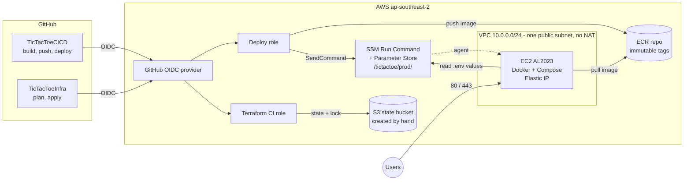

# TicTacToeInfra

Terraform for the AWS side of portfolio project #4: one small EC2 instance
managed through SSM, an ECR repository, a minimal VPC, GitHub OIDC roles and
SSM Parameter Store. No SSH, no stored AWS keys, no hand-made resources (apart
from the state bucket).

The app and its CI/CD pipeline (build, push to ECR, deploy over SSM, smoke
test, rollback) live in
**[joheee/TicTacToeCICD](https://github.com/joheee/TicTacToeCICD)**. This repo
only creates what that pipeline uses and publishes it as outputs. Everything
runs in `ap-southeast-2`.

## Architecture



| Module | Creates |
|---|---|
| `network` | VPC, one public subnet, internet gateway, security group (80 and 443 in, no SSH) |
| `ecr` | Repository (scan on push, immutable tags), lifecycle policy keeping the last 10 images |
| `ssm_parameters` | SecureString parameters under `/tictactoe/prod/` with placeholder values |
| `compute` | Instance role and profile, EC2 (AL2023, encrypted gp3 root volume, IMDSv2 required, no key pair), Elastic IP |
| `github_oidc_provider` | The GitHub OIDC identity provider |
| `github_deploy_role` | Role the app pipeline assumes (pinned to `joheee/TicTacToeCICD` on `main`) |
| `terraform_ci_role` | Role this repo's workflow assumes (pinned to `joheee/TicTacToeInfra`) |

## Outputs

These are the contract with the app repo: copy them into its GitHub Actions
repository variables. Do not rename or remove them.

| Terraform output | App repo variable | What it is |
|---|---|---|
| `aws_region` | `AWS_REGION` | Region everything lives in |
| `github_deploy_role_arn` | `AWS_DEPLOY_ROLE_ARN` | Role the app pipeline assumes through OIDC |
| `ecr_repository_url` | `ECR_REPOSITORY_URL` | Where images are pushed |
| `instance_id` | `EC2_INSTANCE_ID` | SSM Run Command target |
| `app_url` | `APP_URL` | Public URL for the smoke test |
| `ssm_parameter_prefix` | `SSM_PARAM_PREFIX` | Path holding the app's `.env` values |

One extra output is not part of the app contract: `terraform_ci_role_arn`, the
role this repo's own workflow assumes. It goes into this repo's `TF_CI_ROLE_ARN`
variable (not the deploy role).

## First apply

Requires Terraform >= 1.10 and AWS credentials with enough rights to create IAM
roles and the resources above. The first apply runs locally because this stack
creates the OIDC provider and the Terraform CI role that CI later uses.

1. **Create the state bucket by hand** in `ap-southeast-2`: versioned,
   encrypted, public access blocked. Terraform does not manage it.

   ```sh
   BUCKET=tictactoe-tfstate-001   # must be globally unique
   aws s3api create-bucket --bucket "$BUCKET" --region ap-southeast-2 \
     --create-bucket-configuration LocationConstraint=ap-southeast-2
   aws s3api put-bucket-versioning --bucket "$BUCKET" \
     --versioning-configuration Status=Enabled
   aws s3api put-bucket-encryption --bucket "$BUCKET" \
     --server-side-encryption-configuration \
     '{"Rules":[{"ApplyServerSideEncryptionByDefault":{"SSEAlgorithm":"AES256"}}]}'
   aws s3api put-public-access-block --bucket "$BUCKET" \
     --public-access-block-configuration \
     BlockPublicAcls=true,IgnorePublicAcls=true,BlockPublicPolicy=true,RestrictPublicBuckets=true
   ```

2. **Configure the backend.** Copy `backend.hcl.example` to `backend.hcl` and set
   `bucket` and `region`. The file is git-ignored and required for every
   command, because `main.tf` also reads the bucket name from it. Optionally
   copy `terraform.tfvars.example` to `terraform.tfvars` to override defaults.

3. **Init, plan, apply.**

   ```sh
   terraform init -backend-config=backend.hcl
   terraform plan
   terraform apply
   ```

4. **Wire up the repos.**
   - In this repo set the variables `AWS_REGION`, `TF_STATE_BUCKET` and
     `TF_CI_ROLE_ARN` (value: the `terraform_ci_role_arn` output).
   - In TicTacToeCICD set the six variables from the outputs table
     (`terraform output`).

5. **Check the instance** shows as a managed node in SSM Fleet Manager, then
   open a shell with `aws ssm start-session --target <instance_id>`.

## Setting the secret parameters

Terraform creates the parameters with placeholder values and ignores later
changes to the value, so real secrets never enter code or state. Set them once
with the AWS CLI:

```sh
for name in POSTGRES_USER POSTGRES_PASSWORD POSTGRES_DB; do
  read -rsp "$name: " value; echo
  aws ssm put-parameter --region ap-southeast-2 \
    --name "/tictactoe/prod/$name" --type SecureString \
    --value "$value" --overwrite
done
```

`COOKIE_SECURE` starts as `false` and stays that way until HTTPS is set up.

## CI

`.github/workflows/terraform.yml` runs on this repo:

- **Pull request:** `terraform fmt -check`, `validate`, `tflint`, then `plan`,
  posted as a PR comment.
- **Merge to `main`:** `apply`. Its output is hidden unless the apply fails.

It authenticates with the Terraform CI role over OIDC (no stored keys) and
writes `backend.hcl` at run time from the repo variables. Changing the CI
role's own trust or permissions, or the OIDC provider, needs a local apply.

## Destroy

Run it locally, since the CI role is among the things destroyed.

```sh
terraform destroy
```

This removes everything Terraform created, including the ECR repo with its
images and the SSM parameters. The state bucket was created by hand, so delete
it by hand too (empty all object versions first) if you want it gone.

## Estimated monthly cost

Hand calculation for `ap-southeast-2`, 730 hours per month, at on-demand list
prices as I recall them. Check the AWS pricing pages before relying on the
numbers.

| Item | Estimate (USD) |
|---|---|
| EC2 `t3.small`, on-demand (~$0.0264/h) | ~19.30 |
| EBS gp3, 20 GiB (~$0.0912/GiB-month) | ~1.80 |
| Public IPv4 address / Elastic IP (~$0.005/h) | ~3.65 |
| ECR storage (a few small images) | <1 |
| SSM Parameter Store (standard), OIDC, IAM, VPC, S3 state | ~0 |
| Data transfer out | usage based, small |
| **Total** | **~25** |

Not included: NAT gateway, load balancer, RDS and EKS. They are left out on
purpose (Postgres runs in Compose on the instance).

## Out of scope

- HTTPS and a custom domain. Port 443 is open for a reverse proxy (for example
  Caddy on the instance) and an A record to the Elastic IP, both done later and
  outside this repo.
- Multiple environments. There is a single `prod`. A `staging` environment would
  be a separate Terraform workspace or directory with its own `environment`
  value and state key.
- Anything inside the instance beyond Docker setup. Deploys, `.env` creation and
  container restarts belong to the app pipeline.
